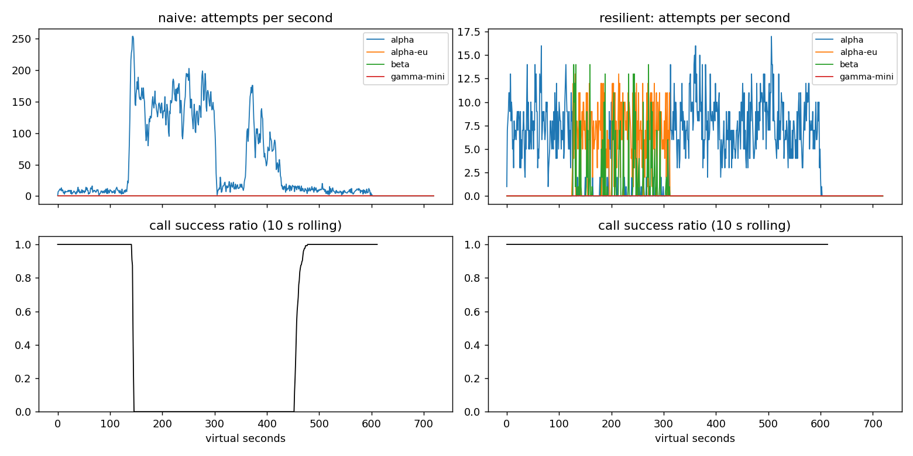

# Lab 25B — Report

**Họ tên / nhóm:** Nguyễn Đình Anh / cá nhân

**MSSV:** 2A202602573

**Commit implementation/evidence:** `e4ec88e`

**Điểm tự động:** 84 / 88; 4 điểm SLO hidden chưa được chấm. Report/postmortem 12 điểm do giảng viên chấm tay.

Commit trên chứa implementation và evidence đã kiểm chứng; commit tiếp theo chỉ cập nhật metadata report. Hash commit bài nộp xem `git log -1`.

Đã đọc `docs/RUBRIC.md` và điền đủ tám mục của `REPORT_TEMPLATE.md`. Evidence chính dùng seed 25. `scoreboard_multiseed.json` kiểm chứng thêm seed 26,27; mọi check public PASS trên cả ba seed. Không có dữ liệu hidden để kết luận về hidden score.

## 1. Kết quả Game Day

Nguồn: `gameday/naive.json`, `gameday/resilient.json`. Recovery là thời gian từ restore đến cửa sổ 30 giây đầu tiên có call success ratio ≥95%; p95 chỉ tính trên các user turn thành công. `N/A` là metric không áp dụng, không phải số 0.

| Băng | Client | availability | p95 (s) | amplification | retry_ratio | cost/turn | recovery (s) | PASS? |
|---|---|---:|---:|---:|---:|---:|---:|:---:|
| G1 | naive | 0.7194 | 7.157 | 7.738 | 6.738 | 2.163 | 4 | FAIL |
| G1 | resilient | 1.0000 | 4.726 | 1.060 | 0.004 | 2.091 | 0 | PASS |
| G2 | naive | 0.4560 | 15.034 | 9.904 | 8.904 | 4.627 | 155 | FAIL |
| G2 | resilient | 1.0000 | 5.224 | 1.034 | 0.007 | 2.114 | 0 | PASS |
| G3 | naive | 1.0000 | 4.768 | 1.164 | 0.164 | 2.328 | 0 | FAIL |
| G3 | resilient | 1.0000 | 4.642 | 1.035 | 0.019 | 2.101 | 0 | PASS |
| G4 | naive | 1.0000 | 13.764 | 1.004 | 0.004 | 2.008 | 0 | FAIL |
| G4 | resilient | 0.9995 | 5.419 | 1.036 | 0.007 | 2.124 | 0 | PASS |
| G5 | naive | 0.3699 | 5.359 | 17.030 | 16.030 | 2.124 | N/A | FAIL |
| G5 | resilient | 0.8179 | 5.484 | 1.008 | 0.007 | 2.518 | N/A | PASS |
| G6 | naive | 0.5170 | 4.836 | 12.344 | 11.344 | 2.009 | 0 | FAIL |
| G6 | resilient | 1.0000 | 5.957 | 1.058 | 0.019 | 2.225 | 0 | PASS |

## 2. Cấu hình client và lý do

Các giá trị là cấu hình nộp; lý do liên hệ kết quả tổng thể, không khẳng định từng giá trị đều đã có thí nghiệm độc lập.

| Tham số | Giá trị | Lý do và evidence |
|---|---:|---|
| attempt_timeout_s | 4 | Healthy median provider 0.6–1.8s; G6 đạt 1.0 availability, trong khi timeout 30 đạt 0.9488. Tránh dành cả deadline 30s cho provider treo. |
| max_attempts_per_provider | 2 | Chỉ một retry mỗi provider rồi failover; G2 amplification 1.034 so với naive 9.904. |
| min_time_left_s | 1 | Không cấp attempt còn dưới 1s; timeout luôn bị cap theo deadline. G6 config chính không có GiveUp. |
| backoff_base_s / cap_s | 0.25 / 4 | Full jitter trong [0,min(4,0.25×2^(n−1))]; retry-after cộng jitter, tránh đồng bộ retry. G1 retry-after violations bằng 0. |
| retry_budget_ratio | 0.1 | Mỗi request đầu nạp 0.1 token, mỗi retry tiêu 1; G3 retry_ratio 0.019, dưới check 0.10. |
| retry_budget_min_per_s / max_tokens | 0.5 / 20 | Nạp tối thiểu 0.5 token/s và burst ban đầu 20; bucket cap 20 để không tích lũy burst vô hạn. Thí nghiệm breaker sai cho thấy budget vẫn giới hạn storm. |
| quota_cooldown_s | 300 | Quota là lỗi billing, không retry; G5 quota bắt đầu t=300 kéo đến cuối t=540, cooldown 300s tránh hỏi lại liên tục. G5 không retry client error. |
| breaker.window_size / min_calls | 20 / 10 | Chỉ giữ 20 kết quả, cần 10 trước trip; tránh trip từ ít mẫu nhưng loại lịch sử healthy cũ. G2 hồi phục metric 0s. |
| failure_rate_threshold | 0.5 | Trip tại ≥50%; G3 30% brownout không nhất thiết cắt primary ngay, được retry/fallback với 1.0 availability. |
| slow_call_s | 5 | Success ≥5s vẫn xấu; G4 extra latency 5s được phát hiện, p95 resilient 5.419 so với naive 13.764. Timeout 4s cũng bắt degradation trước success. |
| slow_rate_threshold | 0.6 | Trip nếu ≥60% kết quả là slow success, tránh một tail riêng lẻ mở breaker. G4 PASS. |
| open_duration_s | 10 | Nghỉ 10s trước probe thay vì gửi tải liên tục; G2/G6 primary share sau restore đạt check ≥0.8. |
| half_open_max_probes / successes | 2 / 2 | Tối đa 2 probe đồng thời, 2 success nhanh để CLOSED; một fail/slow mở lại. 13 breaker tests PASS. |
| fallback_order | alpha → alpha-eu → beta → gamma-mini | Thử cùng model khác region trước đổi family; tool chỉ được dùng ba provider đầu. G6 incompatible_routes=0, bỏ lọc tạo 269 route sai. |

Một tầng retry tại ResilientClient. Breaker khóa thay đổi state/counters; Permit mang generation, kết quả cũ không tác động state mới. Cooldown dùng chung giữa các call.

| Error | Breaker | Retry | Failover/cooldown |
|---|---|---|---|
| 400 và client error | release, không ghi health | không | GiveUp(client_error), không failover |
| 429 insufficient_quota | release | không | cooldown 300s, failover ngay |
| 429 rate limit | release | không retry ngay | cooldown đến retry-after, failover; chỉ đợi cooldown ≤5s nếu hết lựa chọn và đủ deadline |
| 503/529, 5xx, timeout | failure | nếu còn attempt, token, thời gian và breaker cho phép | full jitter; hết điều kiện thì failover |

## 3. Ba thí nghiệm

Reproduce: `python scripts/run_report_experiments.py`. Evidence `experiments.json` lưu settings, seed và metric thực; negative controls chỉ nằm trong script thí nghiệm, không sửa factory/client nộp.

### 3.1 Retry budget là lớp phòng thủ cuối

Theo template, đặt min_calls=1000000000, attempts/provider=5 để breaker không trip. Budget-on giữ 0.1/0.5/20; budget-off dùng ratio=100, refill=1000000/s, max_tokens=1000000000 như negative control được yêu cầu, không dùng config cực đoan này để nộp.

| Băng | Budget | availability | amplification | retry_ratio | p95(s) | recovery(s) |
|---|---|---:|---:|---:|---:|---:|
| G2 | on | 0.9996 | 1.424 | 0.062 | 11.911 | 0 |
| G2 | off | 0.9801 | 1.870 | 0.544 | 19.504 | 0 |
| G3 | on | 1.0000 | 1.136 | 0.068 | 4.568 | 0 |
| G3 | off | 1.0000 | 1.163 | 0.160 | 4.809 | 0 |

Budget giảm retry G2 từ 0.544 xuống 0.062 và giảm p95 19.504→11.911s khi breaker cấu hình sai. Budget-off G2 có 47 GiveUp deadline, budget-on có 1 no_provider_available; recovery đều 0 theo định nghĩa metric nên không chứng minh chênh recovery. Với breaker đúng, config chính G2 amplification 1.034 và retry 0.007 còn thấp hơn. Breaker kiểm soát health từng provider, budget giới hạn tải retry toàn client; cần cả hai để phòng sự cố trước khi đủ mẫu trip hoặc khi cấu hình breaker sai.

### 3.2 Timeout 30s, G4 làm đối chứng

| Băng | timeout | availability | p95(s) | GiveUp |
|---|---:|---:|---:|---|
| G4 | 4 | 0.9995 | 5.419 | no_provider_available: 1 |
| G4 | 30 | 1.0000 | 5.608 | không có |
| G6 | 4 | 1.0000 | 5.957 | không có |
| G6 | 30 | 0.9488 | 5.440 | deadline:107; no_provider_available:15 |

G4 chậm nhưng vẫn trả lời nên timeout dài không mất availability trong mẫu này. G6 alpha-eu treo nên timeout 30 tiêu gần hết deadline, mất cơ hội fallback beta; breaker chỉ có thể mở sau các kết quả timeout. p95 G6 30s thấp hơn không đồng nghĩa tốt hơn: simulator chỉ tính latency của successful turns, loại các turn deadline thất bại. Chọn timeout từ latency healthy/tail, ngân sách end-to-end và thời gian còn lại cho fallback, không chọn theo p95 success đơn lẻ.

### 3.3 Bỏ lọc tool calling

G6 negative control bỏ lọc đạt availability 0.8872, p95 5.650s, incompatible_routes=269 và GiveUp incompatible_model_output=269. Config chính availability 1.0, p95 5.957s, incompatible_routes=0. Với product manager, 269 lần hệ thống gửi thao tác cần gọi công cụ tới model chỉ trả lời văn bản: rẻ/nhanh hơn nhưng không thực hiện được yêu cầu. Vì vậy gamma-mini chỉ là fallback cho chat; breaker/failover không thay thế kiểm tra capability.

## 4. Workflow hoàn tiền

Nguồn `workflows.json`, 500 sessions, seed 25.

| Executor | completion | crashes | duplicate refunds | duplicate emails | lost refunds | overpaid (cents) | wasted LLM/crash |
|---|---:|---:|---:|---:|---:|---:|---:|
| naive | 1.0000 | 81 | 128 | 81 | 0 | 1574200 | 1.123 |
| yours | 1.0000 | 66 | 0 | 0 | 0 | 0 | 0.303 |

Key là `effect:` cộng JSON array [session_id,step]; serialization phân biệt tuple ngay cả khi chuỗi có delimiter. Checkpoint có namespace `checkpoint:` riêng và cùng tuple. Retry ServiceError/ServiceTimeout tối đa 5 attempts với key cũ; WorkerCrash propagate để runner khởi động worker mới. Mỗi step ghi DurableStore sau khi thành công; resume load kết quả để dựng state và skip step đã lưu, tổng 2500 writes cho 500×5 step.

Chỉ idempotency không tránh trả tiền LLM lại và không biết tiến độ; chỉ checkpoint không giải quyết crash giữa payment commit và lưu checkpoint. Ghi checkpoint trước payment có thể bỏ qua payment chưa thực hiện sau crash, dẫn đến lost refund. Stable key cho phép lấy kết quả đã commit an toàn trong khoảng trống đó; không tuyên bố bảo đảm exactly-once nếu API thật không có hợp đồng idempotency/durability tương đương.

## 5. Alerting và error budget

Prefix sum xây O(N), mỗi rolling window O(1); scan O(N×số rule), không cộng lại mọi điểm trong window. Page cần đồng thời 1h/5m ≥14.4x hoặc 6h/30m ≥6x; ticket cần 3d/6h ≥1x. Episode kết thúc exclusive tại phút ngừng firing; window đầu dữ liệu được clip theo contract. Không dùng timestamp/label trong alerter.

Nguồn `slo.json`; độ trễ tính bằng phút.

| Incident | Mong đợi | Naive | Burn-rate | Trễ naive / burn |
|---|---|---|---|---|
| checkout_bug | page | page | page | 1 / 27 |
| provider_outage | page | page | page | 0 / 4 |
| deploy_blip | none | false page | không page | N/A |
| slow_leak | ticket | không ticket | ticket, không page | N/A / 1337 |
| degraded_evening | page | page | page | 214 / 291 |
| night_spike | none | false page | không page | N/A |
| small_bump | none | false page | không page | N/A |

Burn-rate 3 pages, 1 ticket, 0 false page; naive 7 pages, 0 ticket, 3 false page. Tất cả detection delay của burn-rate nằm trong label max-delay. Với 25901755 requests/30 ngày, allowed_bad=(1−0.995)×requests=129508.8 (hiển thị làm tròn); thực tế 55618 bad, availability 0.997853. Budget consumed 42.95%, remaining 57.05%, freeze_releases=False vì budget chưa cạn; tính tỉ lệ trước làm tròn.

small_bump 20 phút ở 12% lỗi tự kết thúc; 1h trung bình xấp xỉ 4% tương ứng 8x dưới 14.4x, 6h dưới 6x. Nó chưa đủ tốc độ tiêu budget để đánh thức on-call, nhưng vẫn cần quan sát và điều tra nếu lặp lại. Đếm bad/request có trọng số lưu lượng, tránh night_spike ít traffic gây page chỉ vì tỷ lệ ngắn cao.

## 6. Postmortem blameless — G2 với naive client

**Tóm tắt:** t=120, alpha mất 75% năng lực cho đến t=300. Client naive retry nhiều tầng vào cùng primary, làm tải khuếch đại 9.904x và availability cả băng chỉ 45.60%. Sau khi provider được phục hồi, vòng retry/queue vẫn kéo dài; recovery metric đạt lại ≥95% ở cửa sổ bắt đầu t=455, 155s sau restore.

**Impact:** 2362 user turns, 1077 tốt và 1285 thất bại trong băng 600s. p95 các turn tốt 15.034s, cost/good turn 4.627; có 34475 attempts cho 3481 logical calls. Với giả định lưu lượng tháng giữ 4 turns/s và SLO user-turn 99.5%, tháng 30 ngày có 10368000 turns, budget 51840 failed turns; sự cố này tiêu 1285/51840=2.4788% budget tháng. Đây là phép ngoại suy theo giả định, không trộn với request-SLI 30 ngày của Part E. Từ trigger đến recovery metric là 335s; CSV không chứng minh mọi giây trong khoảng đều hoàn toàn mất dịch vụ.

**Detection:** không có log alert online của G2 trong simulator; bằng chứng detection là timeseries success ratio suy giảm và attempts tăng mạnh. Burn-rate Part E được kiểm chứng trên bộ SLI riêng, không gán timestamp page của bộ đó cho G2.

**Timeline:** nguồn `gameday/naive_G2_overload_storm_timeseries.csv`. Attempts/s là trung bình [t,t+30); success ratio là calls_ok/calls_done cùng khoảng, không phải tỷ lệ user turns. Hai metric có mẫu/định nghĩa khác nhau.

| t (s) | Sự kiện | Attempts alpha/s | Calls OK/done, 30s |
|---:|---|---:|---:|
| 90 | Trước trigger, ổn định | 7.933 | 234/234 = 100% |
| 120 | Mất 75% GPU; retry bắt đầu tăng | 90.767 | 51/98 = 52.04% |
| 150 | Retry storm hình thành | 140.667 | 0/124 = 0% |
| 240 | Incident vẫn hoạt động | 147.167 | 0/124 = 0% |
| 300 | Provider phục hồi, client chưa hồi phục | 23.433 | 0/55 = 0% |
| 330 | Tải/queue tiếp tục giữ hệ thống suy giảm | 15.833 | 0/114 = 0% |
| 420 | Chưa đạt hồi phục | 21.533 | 0/108 = 0% |
| 455 | Cửa sổ đầu đạt recovery criterion | 10.867 | 352/368 = 95.65% |
| 480 | Ổn định trở lại trong cửa sổ quan sát | 10.433 | 325/325 = 100% |

**Trigger vs technical root cause:** trigger là giảm capacity factor còn 0.25. Root cause là policy retry ba tầng (4×3×3=36 attempts/call), fixed delay 0.2s, không jitter/budget/breaker, không failover và không tôn trọng retry-after. Request timeout không hủy công việc provider đang xử lý; request cũ tiếp tục chiếm hàng đợi trong khi retry mới làm tải vượt năng lực. Khi t=300 phục hồi GPU, công việc tồn và retry vẫn tiếp tục: timeout → retry → thêm queue → timeout là vòng tự duy trì metastable failure. Diễn giải queue dựa trên contract providers.py và biểu hiện CSV, vì CSV không trực tiếp ghi queue length.

**Contributing factors:** thiếu một chủ sở hữu retry xuyên app/gateway/SDK; fallback không được sử dụng; cấu hình healthy chưa được kiểm chứng bằng incident tape. JSON ghi 2737 client_timeout, 3194 overload, 26298 rate_limit và 28381 retry-after violations. Đây là vấn đề thiết kế/kiểm chứng hệ thống, không quy lỗi cá nhân.

**Điều hoạt động / không hoạt động:** capacity phục hồi đúng t=300 và telemetry CSV giúp nhận ra recovery trễ. Fixed-delay retry không tạo khoảng nghỉ đủ cho provider phục hồi; deadline người dùng không khiến work provider dừng. Resilient với breaker/budget/fallback đạt availability 1.0, amplification 1.034, p95 5.224s và recovery 0; đây là mitigation đã đo, không phải bằng chứng dịch vụ thật đã triển khai.

| # | Action | Loại | Owner đề xuất | Cách kiểm chứng |
|---|---|---|---|---|
| 1 | Gộp retry vào một tầng; stable policy, jitter và budget | prevent | Nguyễn Đình Anh / client | CI G2 amplification ≤1.2; G3 retry_ratio ≤0.10; không retry 400 |
| 2 | Sliding-window breaker, slow detection, generation và probe cap | mitigate | Nguyễn Đình Anh / reliability | 13 breaker tests; G2 recovery ≤30s, availability ≥0.95 trên 3 seed |
| 3 | Alert đồng thời long/short burn; dashboard attempts và provider health | detect | On-call/platform (đề xuất) | Public SLI 0 false page, page đúng max-delay; kiểm tra stale traffic vẫn báo outage |
| 4 | Run incident tapes trước release, kiểm tra capability và timeout | prevent | Nguyễn Đình Anh / CI | G1–G6 PASS trên seed 25,26,27; G6 incompatible_routes=0 |

## 7. Một điểm yếu còn lại

Khi cả bốn provider outage, cache chỉ cứu FAQ chung; C1 cached overall availability 0.9117, dù FAQ 0.9634, vẫn có 248 GiveUp no_provider_available. Personal request không được cứu bằng stale vì privacy/freshness; chat/tool không có FAQ entry cũng không được cache. Hướng cải thiện là graceful degradation theo nghiệp vụ, hàng đợi thao tác phù hợp deadline và alert provider-health tách khỏi cache; không nới privacy chỉ để làm dashboard xanh. Cần benchmark tail latency thêm vì G2 p95 5.224s vẫn lớn hơn healthy median 1.2s của alpha.

## 8. Cache (Part G)

Nguồn `cache/resilient.json`, `cache/cached.json`, seed 25.

| Client | availability | FAQ availability | hit ratio | stale served | wrong | outdated | cost/turn | PASS |
|---|---:|---:|---:|---:|---:|---:|---:|---|
| resilient | 0.8373 | 0.8424 | 0.000 | 0 | 0 | 0 | 1.386 | FAIL FAQ availability/hit |
| cached | 0.9117 | 0.9634 | 0.591 | 190 | 0 | 2 | 0.956 | PASS |

| Tham số | Giá trị | Lý do |
|---|---:|---|
| similarity_threshold | 0.92 | 0 wrong, 59.1% hit; 0.80 nhầm 181 câu; 0.97 hit 49.8%, dưới mục tiêu 50%. |
| ttl_s | 30 | 2 outdated so với 95 khi TTL 300; giữ fresh age≤30s, không kéo dài TTL theo mỗi hit. |
| max_stale_s | 180 | Entry dùng đến tuổi TTL+180=210s; đủ outage 120s với khoảng refresh trước đó. 190 stale served, FAQ availability 96.34% so với 85.29% nếu tắt stale. |
| max_entries | 500 | Có giới hạn LRU; catalog 18 shared intents × scope v1/v2 nhỏ hơn cap. Capacity không là nút thắt quan sát được; chưa có benchmark để khẳng định 500 là tối ưu. |
| scope / invalidation | prompt_version / source | Không dùng v1 cho v2; webhook xóa mọi entry có source liên quan, kể cả stale. wrong_answers_by_reason={} cho cấu hình chính. |

Fresh hit trả Serve không gọi provider. Stale entry được giữ nhưng healthy miss vẫn gọi provider để refresh. Chỉ sau GiveUp lookup lại ngay tại thời điểm hiện tại (tránh reuse entry đã invalidated/expired) rồi Serve stale; không có hit thì giữ GiveUp. Không lookup/store personal, success chỉ lưu Answer thật từ call.answer và báo inner breaker trước.

### 8.1 Ngưỡng similarity

| Threshold | hit ratio | wrong_answers | reason | cost/good turn |
|---:|---:|---:|---|---:|
| 0.80 | 0.609 | 181 | other_question:181 | 1.017 |
| 0.92 | 0.591 | 0 | không có | 0.956 |
| 0.97 | 0.498 | 0 | không có | 1.018 |

0.80 coi các intent gần nhau là cùng câu hỏi; catalog có refund policy/time, exchange size/color và shipping fee city/province. Metric chỉ ghi reason, không ghi số nhầm theo từng cặp nên không gán 181 cho một cặp cụ thể. 0.92 giữ paraphrase nhưng loại near miss; 0.97 an toàn trong mẫu nhưng bỏ nhiều hit hơn và tăng cost.

### 8.2 TTL

| TTL(s) | outdated | FAQ availability | hit ratio | cost/turn |
|---:|---:|---:|---:|---:|
| 30 | 2 | 0.9634 | 0.591 | 0.956 |
| 60 | 3 | 0.9640 | 0.652 | 0.916 |
| 300 | 95 | 0.9640 | 0.731 | 0.863 |

TTL 300 tiết kiệm request nhưng vi phạm outdated≤15. Refund update t=150 có webhook nên invalidation xử lý ngay; shipping update t=480 không có webhook nên cache không biết đổi nội dung. TTL buộc revalidation định kỳ khi provider healthy; không có cơ chế thông báo khác trong lab để chặn stale content sớm hơn. TTL 30 chọn thiên về freshness; TTL 60 cũng đạt public seed 25 nhưng chưa được chọn chỉ vì giảm cost.

### 8.3 Stale-if-error

Giữ threshold 0.92/TTL30 và tắt stale: FAQ availability giảm 0.9634→0.8529, hit ratio 0.591→0.481; wrong vẫn 0, outdated vẫn 2. GiveUp no_provider_available tăng 248→438, chênh 190 đúng số stale served trong config chính. Stale window bảo vệ outage t=240–360; deploy v2 t=420 vẫn miss scope v1 và webhook t=150 không cho dùng lại entry bị xóa.

**Privacy:** câu hỏi cá nhân thay đổi nhanh và có dữ liệu riêng; cùng embedding không đồng nghĩa cùng user/order. Kể cả cache theo user, trạng thái đơn/refund có thể đổi trước TTL, và hợp đồng lab không cho cache personal. Không dùng giải pháp đó để tăng hit ratio.

**Alert khi cache che outage:** theo dõi provider attempts/error/timeout, breaker OPEN/HALF_OPEN và stale_served rate/age ngoài end-user availability. C1 có 190 stale served và 94 service_unavailable ở cached client, dù FAQ availability 96.34%. Page dựa trên multi-window health SLI cùng budget phù hợp; không chỉ page theo cache miss hay màu xanh dashboard. Các metrics này là evidence lab, chưa có rule health riêng được triển khai.

## Kiểm chứng và chuẩn bị nộp

- Sáu file unit test chính: 76 tests PASS; các file test/sim/service/scenario không sửa.
- Grade mặc định: 84/88; multi-seed 25,26,27: 84/88, G1–G6/C1/workflows/SLO public đều PASS. Hidden SLO chưa có evidence, report chưa được chấm tay.
- Evidence giữ lại: scoreboard mặc định và multi-seed, gameday/cache JSON+CSV, workflows.json, slo.json, experiments.json, hình G2; không chạy clean.
- Reproduce: `python -m pytest tests/test_errors_retry.py tests/test_breaker.py tests/test_client.py tests/test_cache.py tests/test_executor.py tests/test_alerting.py -q`; các script run_gameday/run_workflows/run_slo/grade theo Makefile; plot dùng `MPLBACKEND=Agg` trong môi trường không có UI.
- Repo hiện tại `K4-Track03-NguyenDinhAnh-2A202602573-Circuit-Breakers-Caching-Reliability`; tên yêu cầu `Track3-Day25-2A202602573-Nguyễn-Đình-Anh`. Chưa rename remote/history.
- Trạng thái push và hash commit nộp được xác minh bằng Git sau khi commit; không coi việc tạo report là bằng chứng đã push.
